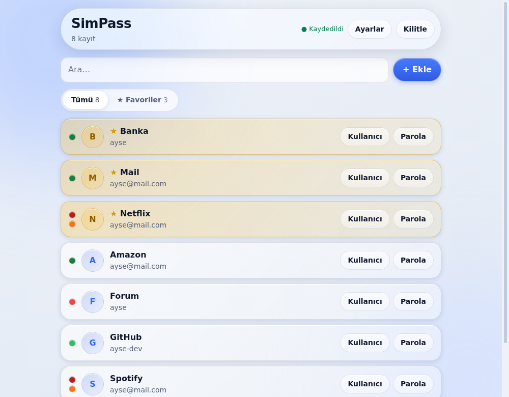
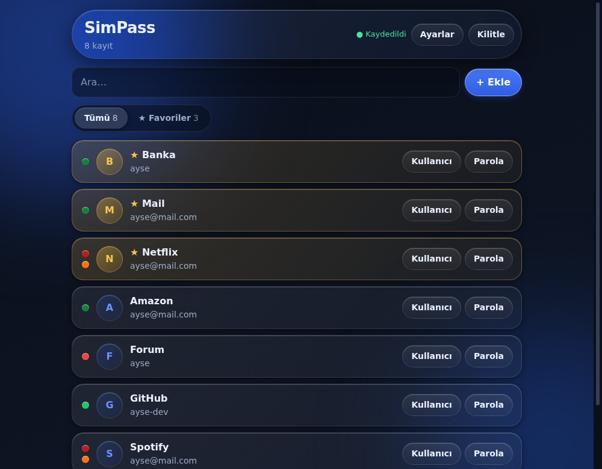
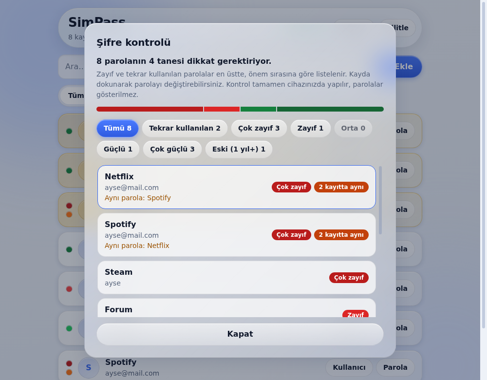
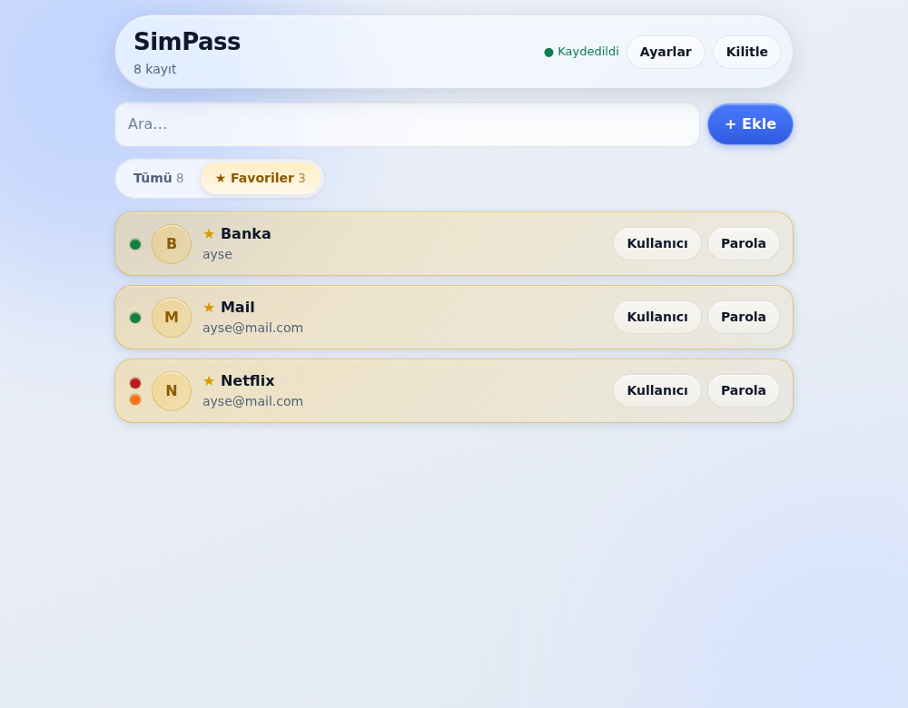
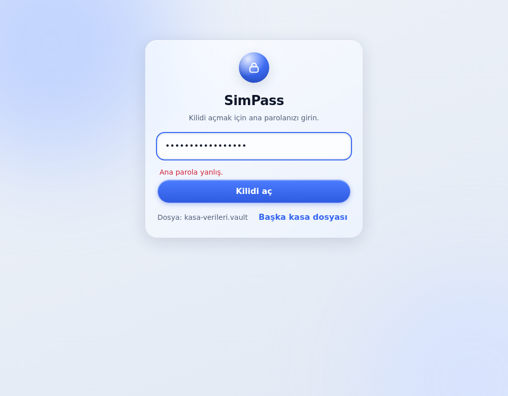
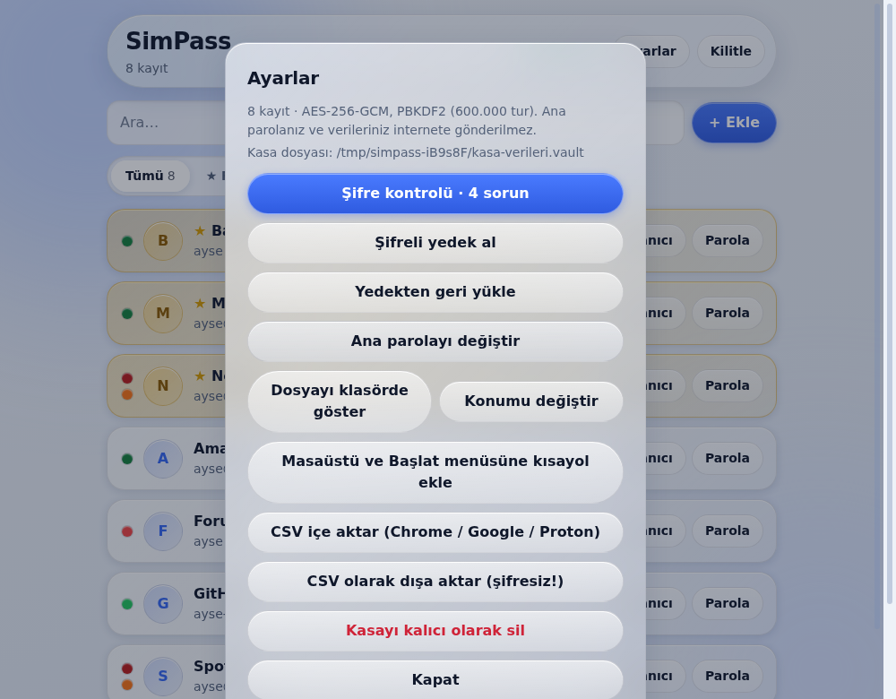

# SimPass

**Yerel ve şifreli masaüstü şifre yöneticisi.** Parolalarınız yalnızca kendi bilgisayarınızda, ana parolanızla şifrelenmiş tek bir dosyada durur. Uygulama internete hiçbir şey göndermez.

Windows için hazırlanmış bir [Electron](https://www.electronjs.org/) uygulamasıdır. Arayüz, modern "liquid glass" (buzlu cam) görünümünde, açık ve koyu temayı destekler.

<p align="center">
  
  
</p>

## Özellikler

- **Şifreli kasa dosyası:** Tüm kayıtlar tek bir dosyada, AES-256-GCM ile şifrelenir. Dosyayı OneDrive gibi bir klasöre taşıyabilir, yedeğini alabilirsiniz.
- **Kayıtlar:** Başlık, web sitesi, kullanıcı adı, parola ve not. Arama ve **Tümü / Favoriler** filtresi var. Favori kayıtlar altın tonlu camla ayrışır.
- **Parola durumu bir bakışta:** Her kaydın solunda renkli noktalar bulunur. Nokta rengi parolanın gücünü, turuncu ikinci nokta ise parolanın başka kayıtlarda da kullanıldığını gösterir. Üzerine gelince açıklama çıkar.
- **Şifre kontrolü:** Tüm parolaları önem sırasına göre listeler. Zayıf, tekrar kullanılan ve 1 yıldan eski parolaları filtreleyebilirsiniz. Parolalar bu ekranda gösterilmez.
- **Parola üretici:** Tarayıcının güvenli rastgele sayı üretecini (`crypto.getRandomValues`) kullanır. Uzunluk ve sembol seçeneği vardır.
- **Kopyalama:** Kullanıcı adı ve parola tek tıkla kopyalanır. Panoda hâlâ aynı içerik duruyorsa 30 saniye sonra temizlenir.
- **Otomatik kilit:** 5 dakika hareketsizlikte, pencere 2 dakikadan uzun arka planda kalırsa, ekran kilitlendiğinde veya bilgisayar uykuya geçtiğinde.
- **İçe/dışa aktarma:** Chrome, Google Şifre Yöneticisi ve Proton Pass CSV dosyalarını içe aktarır. Şifreli yedek alıp geri yükleyebilirsiniz. CSV dışa aktarma **şifresizdir**, kullandıktan sonra silin.
- **Ana parolayı değiştirme**, kasa dosyasını **başka klasöre taşıma**, masaüstü ve Başlat menüsü **kısayolu** oluşturma.

<details>
<summary>Daha fazla ekran görüntüsü</summary>

<p align="center">
  
  
  
  
</p>

</details>

## Kullanım (hazır sürüm)

1. [Sürümler](../../releases) sayfasından `SimPass-win32-x64.zip` dosyasını indirin.
2. Zip'i çıkarmadan önce sağ tıklayıp **Özellikler → Engellemeyi kaldır** kutusunu işaretleyin. Uygulama bir sertifikayla imzalı olmadığı için Windows aksi hâlde "bilinmeyen yayıncı" uyarısı gösterebilir. Uyarı çıkarsa **Daha fazla bilgi → Yine de çalıştır** ile geçebilirsiniz.
3. Zip'i çıkarın ve `SimPass.exe` dosyasını çalıştırın. Kurulum gerekmez.
4. İlk açılışta bir **ana parola** belirleyin (en az 12 karakter). **Ana parolayı unutursanız kasa kurtarılamaz.**

Kasa dosyası varsayılan olarak `%APPDATA%\SimPass\kasa-verileri.vault` konumundadır. Uygulama klasörünü silmek veya güncellemek kasanızı etkilemez. Ayarlar menüsünden dosyayı klasörde gösterebilir veya taşıyabilirsiniz.

## Güvenlik

### Şifreleme

| Konu | Uygulama |
| --- | --- |
| Anahtar türetme | PBKDF2-HMAC-SHA-256, 600.000 tur, 16 baytlık rastgele tuz |
| Şifreleme | AES-256-GCM (kimlik doğrulamalı), her kayıtta yeni 96 bitlik rastgele IV |
| Anahtar | WebCrypto'da dışa aktarılamaz (`extractable: false`) olarak tutulur, diske yazılmaz |
| Yazma | Önce geçici dosyaya yazılır, sonra yeniden adlandırılır (yarım yazma riski azalır) |
| Ana parola | En az 12 karakter, hiçbir yere kaydedilmez veya gönderilmez |

### Uygulama sertleştirmesi

- **Ağ erişimi kapalı:** İçerik güvenlik politikası (`connect-src 'none'`), `file://` dışındaki tüm isteklerin engellenmesi, tüm izin isteklerinin reddi, gezinme ve yeni pencere engeli.
- **İzolasyon:** `contextIsolation` ve `sandbox` açık, `nodeIntegration` kapalı, geliştirici araçları devre dışı. Arayüz yalnızca `preload.js` içindeki dar bir IPC köprüsünden ana sürece erişir.
- **Electron fuses:** `RunAsNode`, `NODE_OPTIONS` ve `--inspect` kapalı, uygulama yalnızca `app.asar` içinden yüklenir.
- **Tek örnek:** Aynı anda yalnızca bir SimPass penceresi çalışır.

### Sınırlar (bilmeniz gerekenler)

- SimPass **bağımsız bir güvenlik denetiminden geçmedi.** Çok kritik hesaplar için denetlenmiş bir yönetici (ör. Proton Pass, Bitwarden) kullanmak daha güvenlidir.
- Bilgisayarınızda zararlı yazılım (keylogger, ekran kaydedici vb.) varsa hiçbir yerel şifre yöneticisi sizi koruyamaz.
- Kasa açıkken çözülmüş veriler bellekte durur ve bellek sıfırlanmaz.
- Parola gücü, **kural tabanlı bir tahmindir** (uzunluk, karakter çeşitliliği, yaygın kelime, ardışık dizilim ve tekrar cezası). Sözlük tabanlı bir analiz değildir. "Güçlü" etiketini kesin güvence saymayın.
- Çalıştırılabilir dosya **kod imzalı değildir**, bu yüzden Windows SmartScreen uyarı verebilir. İsterseniz kaynak koddan kendiniz derleyebilirsiniz.
- Otomatik güncelleme ve çoklu cihaz senkronizasyonu henüz yok.

## Veri biçimi

Kasa dosyası (`.vault`) düz JSON'dur. Kayıtların tamamı `ct` alanında tek bir şifreli blok olarak durur:

```json
{ "v": 1, "salt": "<base64>", "iv": "<base64>", "ct": "<base64>", "saved": 1760000000000 }
```

Şifre çözüldüğünde `ct`, şu şekilde kayıtlardan oluşan bir JSON dizisidir:

```json
{ "id": "uuid", "t": "Başlık", "url": "https://…", "n": "kullanıcı", "p": "parola", "nt": "not", "f": 0, "u": 1760000000000 }
```

Silinen kayıtlar 30 gün boyunca `{ "id", "del": true, "u" }` biçiminde saklanır. Bu sayede kasa dosyası bulut klasörleri aracılığıyla iki yerden değiştirilirse kayıtlar `u` zaman damgasına göre birleştirilir.

## Geliştirme

Gereksinimler: [Node.js](https://nodejs.org/) 22 veya üzeri (test edilen sürüm).

```bash
npm install          # bağımlılıkları kurar
npm start            # uygulamayı geliştirme modunda açar
npm run build:win    # dist/SimPass/SimPass.exe üretir (Wine gerekmez)
npm run test:e2e     # gerçek Electron penceresinde uçtan uca test
```

Linux'ta test için sanal ekran gerekir:

```bash
xvfb-run -a npx electron --no-sandbox test/e2e.js
```

`npm run build:win`, Electron'un Windows sürümünü indirir, uygulamayı `app.asar` olarak paketler, `SimPass.exe` için simge ve sürüm bilgisini ekler ve güvenlik ayarlarını (fuses) uygular. Çıkan `dist/SimPass` klasörünü zip'leyip dağıtabilirsiniz.

> `npm audit` derleme araçlarında (ör. `extract-zip`) uyarı verebilir. Bu paketler yalnızca derleme sırasında kullanılır, çıkan uygulamaya dahil edilmez.

### Proje yapısı

```
src/
  main.js        Ana süreç: pencere, kasa dosyası okuma/yazma, IPC, güvenlik ayarları
  preload.js     Arayüze açılan dar IPC köprüsü (window.simpass)
  renderer.js    Arayüz ve tüm şifreleme mantığı (WebCrypto)
  index.html     Kabuk ve içerik güvenlik politikası
  style.css      Liquid glass tasarımı
assets/          Uygulama simgesi (ico, png)
scripts/         Windows derleme betiği
test/e2e.js      Uçtan uca test
docs/            Ekran görüntüleri ve kullanım notu
```

## Yol haritası

- Mobil uygulama ve hesap tabanlı çoklu cihaz senkronizasyonu
- Kod imzalama ve otomatik güncelleme
- Kurtarma anahtarı

## Lisans

[MIT](LICENSE)
